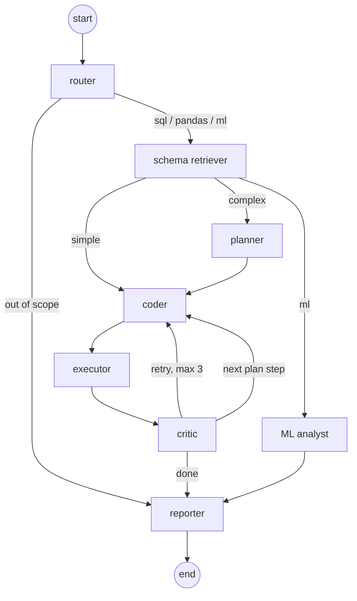

# DataPilot

A self-correcting, multi-agent data analyst. You upload a CSV, Excel or SQLite file and
ask a question in plain English. A LangGraph workflow then plans the analysis, writes
DuckDB SQL or pandas code, runs it in a sandbox, checks the result and fixes its own
mistakes. Predictive questions ("which customers are likely to churn?") are answered
with real scikit-learn models. Each answer comes with a short explanation, the result
table, the generated code and a chart where one helps.

<!-- Demo GIF: docs/demo.gif -->

## How it works



| Agent | What it does |
|---|---|
| Router | Picks SQL, pandas, ML or out of scope. Rewrites follow-ups like "now only for Europe" into standalone questions. |
| Schema retriever | Profiles every column. For large schemas, it picks only the relevant tables and columns using MiniLM embeddings in FAISS. |
| Planner | Splits multi-part questions into ordered steps. |
| Coder + executor | Writes DuckDB SQL or pandas and runs it read-only, with row and time limits. |
| Critic | Classifies errors, runs sanity checks and an LLM review, then sends feedback to the coder (up to 3 retries). |
| ML analyst | Validates the proposed target and features, then compares 3 model families with 5-fold CV. |
| Reporter | Writes the answer and picks a chart that fits the result. |

Every step logs latency, tokens and retries. More detail is in
[docs/design.md](docs/design.md).

## Quick start

You need Python 3.11 and [uv](https://docs.astral.sh/uv/). Create a `.env` file:

```bash
GROQ_API_KEY=your-key
```

By default DataPilot uses Groq with `llama-3.3-70b-versatile`. For any other
OpenAI-compatible API (OpenAI, OpenRouter, Ollama, ...), set `LLM_PROVIDER=openai`,
`OPENAI_API_KEY`, `OPENAI_BASE_URL` and `LLM_MODEL` instead.

```bash
uv sync
uv run datapilot-ping                       # check the LLM connection
uv run streamlit run app/streamlit_app.py   # web app with sample datasets
uv run datapilot-ask --data data/samples/retail.sqlite "Top 5 countries by revenue"
```

With Docker:

```bash
docker build -t datapilot .
docker run --rm -p 8501:8501 --env-file .env datapilot
```

In the app you can also paste an API key in the sidebar instead of using `.env`. The
key stays in your browser session and is never stored.

## Deploy

The app is deployed for free on [Streamlit Community Cloud](https://share.streamlit.io),
straight from this GitHub repo. Visitors paste their own API key, so hosting it costs
nothing.

1. Sign in at share.streamlit.io with GitHub and choose **Create app**, then deploy from
   this repository: branch `main`, main file `app/streamlit_app.py`.
2. Under **Advanced settings**, choose **Python 3.11** and add this secret:
   ```toml
   EMBEDDING_MODEL = "hashing"
   ```
   It uses the lightweight schema embedder, so PyTorch is never loaded and the app stays
   within the free memory limit.
3. Click **Deploy**. Dependencies are installed from `uv.lock`, and each push to `main`
   redeploys the app.

## Evaluation

```bash
uv run datapilot-prepare-benchmark   # 200 Spider dev questions, fixed seed 42
uv run datapilot-eval                # single LLM call vs agent without critic vs full agent
uv run datapilot-summarise           # tables and charts in reports/
uv run datapilot-train-confidence    # answer-confidence model from the run logs
uv run datapilot-ml-eval             # ML pipeline on three public datasets
```

The evaluation measures execution accuracy, valid-SQL rate, retries, latency and tokens
per question. LLM replies are cached, so re-runs are free, and an interrupted run
resumes where it stopped.

## Results

**ML pipeline.** For each dataset, the best of logistic/linear regression, random forest
and gradient boosting was chosen by 5-fold CV, then scored once on a held-out 20% test
split.

| Dataset | Task | Best model | Test score |
|---|---|---|---|
| Customer churn (UCI, 3,150 rows) | Classification | Gradient boosting | ROC-AUC 0.993, F1 0.907 |
| California housing (20,640 rows) | Regression | Gradient boosting | R² 0.835, RMSE 0.465 |
| Adult income (48,842 rows) | Classification | Gradient boosting | ROC-AUC 0.929, F1 0.711 |

**Scoring harness.** Predicted SQL runs on DuckDB copies of the Spider databases, so I
replayed the gold SQL on those copies. 129 of the 132 queries that DuckDB can run give
the same result as on SQLite. The other 3 differ only through ties under `LIMIT` or
`ORDER BY`, and one query that averages a date column.

**Text-to-SQL.** Not run to completion yet. The commands above produce the table.

## Design choices

- **DuckDB with a read-only connection and external file access turned off**, so
  model-written SQL can't change data or read files.
- **Cheap checks before the LLM.** The critic runs rule-based checks before asking the
  LLM reviewer. Execution errors and rule violations get up to 3 retries; a reviewer's
  objection gets only 1.
- **The LLM proposes, code decides.** In the ML analyst, the model only suggests the
  target and features. Validation (IDs, constants, leakage), preprocessing and metrics
  are ordinary code.
- **A layered Python sandbox**: an AST allow-list, restricted builtins, and an isolated
  subprocess with an audit hook and a timeout. Results come back as Arrow, not pickle,
  so nothing the code produces can run in the main process.

## Limitations

- Answer quality depends mostly on the LLM.
- The sandbox is defence in depth, not container isolation.
- There is no benchmark yet for the router or for multi-step "why" questions.

## Project layout

```
app/streamlit_app.py   Streamlit UI
src/datapilot/
  agents/              router, planner, retriever, coder, executor, critic, ML analyst, reporter
  graph/               LangGraph state, workflow and tracing
  tools/               SQL executor, Python sandbox, charts
  data/  rag/  ml/     loading and profiling, schema index, scikit-learn pipelines
  llm/                 provider wrapper and reply cache
  eval/                benchmark, runner, reports
data/samples/          demo datasets
docs/design.md         design notes
```

## Data

The demo data comes from the UCI Machine Learning Repository: Online Retail II and the
Iranian Churn Dataset, both under CC BY 4.0 (see
[data/samples/README.md](data/samples/README.md)). The evaluation uses the Spider dev set
(CC BY-SA 4.0), California Housing and Adult. Those are downloaded by the scripts and
not stored in the repo.
