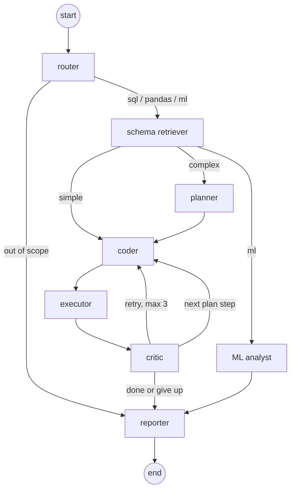

# DataPilot design notes

These notes explain how DataPilot is put together and why I made the choices I did.
The README has the short version; this is the longer one.

## 1. The graph

DataPilot is a LangGraph `StateGraph`. Each node is a plain Python function that takes
the shared state and returns the keys it wants to change.

| Node | File | What it does |
|---|---|---|
| Router | `agents/router.py` | Picks `sql`, `pandas`, `ml` or `out_of_scope`, flags multi-part questions and rewrites follow-ups ("now only for Europe") into standalone questions using the conversation history. |
| Schema retriever | `agents/schema_retriever.py` | Chooses which tables and columns go into the prompt (section 4). |
| Planner | `agents/planner.py` | Only runs for complex questions. Splits them into 2 to 4 ordered steps. |
| Coder | `agents/coder.py` | Writes DuckDB SQL or pandas code for the current step. On a retry it sees its previous code and the critic's feedback. |
| Executor | `agents/executor.py` | Runs the code with the safe SQL executor or the Python sandbox. |
| Critic | `agents/critic.py` | Rule-based checks plus an LLM review. Sends feedback back to the coder, or accepts the step. |
| ML analyst | `agents/ml_analyst.py` | Handles predictive questions with real scikit-learn models (section 6). |
| Reporter | `agents/reporter.py` | Writes the answer in plain language and proposes a chart, which is validated against the actual result. |

Every node is wrapped by `graph/tracing.py`, which logs latency, LLM calls, prompt and
completion tokens, the retry count and a short detail string (for example
`retry (unknown_column)`). The log is part of the state (`trace`, appended with a
reducer), so the app, the CLI and the evaluation all read the same numbers.

## 2. State

`graph/state.py` defines `AgentState` as a `TypedDict`. It holds the question and
conversation history, the route, the plan and current step, the retrieved schema text,
every code attempt (`Attempt`), the finished steps (`StepResult`), retry counters, the
error categories seen so far, the ML report, and finally the answer, chart, result table
and confidence.

Conversation memory is a list of `Turn`s (question, standalone question, route, code,
answer) passed in with each new question. I kept memory outside LangGraph's
checkpointer on purpose: the state holds DataFrames, and the app only needs the last
few turns, not a replayable history.

## 3. Self-correction

The critic runs in three stages and stops at the first problem it finds:

1. **Execution errors.** The executors classify failures into an error taxonomy
   (`errors.py`): syntax error, unknown table, unknown column, type mismatch, timeout,
   unsafe code and so on. For unknown names the feedback includes the closest matches
   from the schema (`difflib`), which fixes most typos in one retry.
2. **Sanity rules.** These catch results that run but are probably wrong: an empty
   result, all-NULL columns, negative counts, percentages above 100, a join that returns
   more rows than any input table, or several rows for a "how many / what is the total"
   question. An empty result is only challenged once. If the retry is empty too, I treat
   that as the honest answer.
3. **LLM review.** The verifier sees the step, the code and a preview of the result and
   checks the semantics: wrong aggregation, missing filter, wrong time period. It is told
   not to ask for cosmetic changes, because an over-eager reviewer causes pointless
   retries.

Objective problems (stages 1 and 2) get up to three retries per step. An LLM reviewer's
objection is an opinion, so it gets only one retry per step. I added this after testing
with Llama 3.3 70B, whose verifier kept raising vague objections ("missing filter for Q3
and Q4" on a query that already handled the quarters). Each objection cost a full retry
without improving the answer, so after the cap the result is kept with a warning. When
the retries run out, a result that still runs is kept with a warning, which the reporter
passes on. If nothing ran, the reporter says plainly that it could not answer and shows
the last error.

## 4. Schema retrieval (RAG)

When a schema is small (40 columns or fewer by default) the whole profile goes into the
prompt, because leaving out a column there only costs accuracy. Larger schemas are
indexed:

- one document per table and one per column, built from the profile: humanised names,
  type, original header and a few sample values;
- embedded with `all-MiniLM-L6-v2` (sentence-transformers) and stored in a FAISS
  inner-product index;
- at question time, each column's cosine score gets a small bonus if its name or one of
  its sample values appears literally in the question (cheap hybrid retrieval);
- tables are ranked by their best score, and those within a margin of the best are kept;
- "bridge" tables that share key columns with two chosen tables are added so joins
  remain possible;
- wide tables are trimmed to their top columns plus all key columns.

The profile (`data/schema.py`) is what makes the prompts useful. Besides types it
includes value ranges, null rates, approximate distinct counts and the most frequent
values of text columns, so the model knows that the country is spelled
"United Kingdom" and that dates run from 2009 to 2011.

## 5. Safe execution

**SQL** (`tools/sql_executor.py`)

- `duckdb.extract_statements` must return exactly one statement of type `SELECT`
  (CTEs included). Anything else is rejected before it runs.
- The workspace is opened `read_only=True` with `enable_external_access=false`, so
  even a SELECT cannot call `read_csv('C:/...')` or attach another database.
- A timer calls `connection.interrupt()` after the time limit.
- Results are fetched in chunks up to a row limit and flagged when truncated.

**Python** (`tools/python_sandbox.py`) uses three layers:

1. A static AST check: only `pandas`, `numpy`, `math`, `statistics`, `datetime`, `re`,
   `collections` and `itertools` may be imported. No names or attributes starting with an
   underscore, no `open`/`eval`/`exec`/`getattr`, and no pandas or numpy I/O helpers
   (`read_*`, most `to_*`, `np.load`, ...).
2. Execution with a trimmed `builtins` dictionary and an import hook that enforces the
   same allow-list.
3. A fresh, isolated Python interpreter (`python -I`) with a timeout. Inside it, a Python
   audit hook (which cannot be removed once installed) refuses file writes, reads
   outside the Python installation, sockets, subprocesses and `os.system`.

The result comes back as Apache Arrow, not pickle. Arrow is data only, so nothing the
untrusted code produces can execute in the main process when it is read. I first used
`multiprocessing`, but its spawn mode re-imports the calling script in the child, so a
script without a main guard started itself again. A plain subprocess avoids that.

This is defence in depth for a single-user analyst tool. A multi-tenant service should
also run the child in a container without network access.

## 6. Machine learning

For predictive questions the LLM only proposes the setup: table, target, features and
ID column. Everything else is ordinary, testable code in `ml/pipelines.py`:

- **Validation.** Unknown columns, identifiers (ID-like names with almost all values
  unique), constants, mostly-missing columns and high-cardinality text are dropped, each
  with a reason. Any single feature that predicts the target almost perfectly
  (AUC/|r| ≥ 0.99, or ≥ 99% purity for categoricals) is treated as likely leakage and
  dropped with a warning.
- **Preprocessing.** A `ColumnTransformer` with median imputation and scaling for
  numbers, and most-frequent imputation and one-hot encoding (rare levels grouped) for
  categories. Timestamps become year/month/day-of-week.
- **Models.** Logistic/linear regression, random forest and histogram gradient
  boosting. Classifiers use balanced class weights so a 15% churn class is not ignored.
- **Evaluation.** An 80/20 stratified split, then 5-fold cross-validation on the
  training part to choose the model (ROC-AUC for binary, macro F1 for multi-class, RMSE
  for regression). The chosen model is refit and scored once on the test set:
  precision, recall, F1, accuracy and a confusion matrix, or MAE/RMSE/R².
- **Explanations.** Permutation importance on the raw columns of the test set, so the
  drivers read as "complains" rather than "onehot__complains_1".
- **Warnings** for small samples, class imbalance and suspiciously perfect test scores.
- **"Who will churn?"** Rows that have not churned are ranked by out-of-fold
  probabilities from `cross_val_predict`, so no customer is scored by a model that saw
  them in training.

## 7. Evaluation

`datapilot-prepare-benchmark` downloads Spider and samples 200 of the 1,034 dev
questions with `random.Random(42)`. `datapilot-eval` then runs three variants on the
same questions:

1. **baseline**: one LLM call with the full schema profile, executed once;
2. **agent_no_critic**: the full graph with the critic replaced by a pass-through;
3. **agent_full**: the graph with the critic and up to three retries.

The router is restricted to `sql` here, because the benchmark is pure text-to-SQL.

**Scoring.** A prediction is correct when its result matches the gold query's result
on the original SQLite database: values are normalised (numbers rounded to 4 decimals,
dates as ISO strings), columns may be permuted, and row order only counts when the gold
query has `ORDER BY`. This is the usual "execution accuracy" for Spider. Predicted SQL
runs on a DuckDB copy of each database, so I wrote a harness check
(`datapilot-eval --check-harness`) that replays the gold SQL on DuckDB with the same
comparison. Of the gold queries that are valid DuckDB SQL, 129 of 132 reproduce exactly.
The three that don't are ties under `LIMIT 1` or `ORDER BY`, plus one query that averages
a date column. So the DuckDB conversion and the comparison are not what limits the
score.

**Cost and caching.** Every LLM reply is cached in SQLite, keyed on the model,
messages and options. A re-run therefore costs nothing and reproduces the same
answers. A cache hit keeps the token counts and the latency of the original call, so
the cost columns of the report also stay the same.

`datapilot-summarise` writes `reports/text_to_sql_results.{md,csv}`, a breakdown by gold
query type, and charts for accuracy, cost and the error categories seen during runs.

## 8. Confidence model

`ml/confidence_model.py` learns whether an answer is likely correct from signals that
exist at run time: retries, the kinds of errors seen, whether the first attempt failed,
result size, query shape (joins, nesting, GROUP BY, window functions, LIMIT), the
number of plan steps and the number of tables in the prompt. It is trained on the
agent-variant evaluation logs, where correctness is known. It compares logistic
regression with gradient boosting using 5-fold ROC-AUC and Brier score, and saves the
winner.

At run time the critic scores each accepted step. When the score falls below the
threshold (0.5 by default) it runs one extra, stricter LLM review, which can still send
the step back for a retry. The reporter shows the final score in the UI.

## 9. Decisions and trade-offs

- **DuckDB** instead of SQLite or pandas-only: it is fast on analytical queries,
  understands dates well, reads CSV/Parquet itself and has a real read-only mode with
  external access switched off. That last point is what makes it safe to run model-written
  SQL.
- **Direct OpenAI-compatible client** instead of LangChain chat models: Groq and most
  other providers speak the same API, so one small wrapper covers them all. Calling the
  API directly also keeps the token counts and latency exact for the logs. LangGraph
  nodes are plain functions and do not need LangChain model objects.
- **JSON-mode replies everywhere**, parsed with a tolerant parser. Agents fall back to
  safe defaults (for example the router falls back to `sql`) rather than crashing on a
  malformed reply.
- **A hashing embedder** with the same interface as the MiniLM embedder lets retrieval
  run offline, without downloading a model.
- **Namespace packages and no underscores**: a project rule. No file or identifier
  starts with an underscore, and the code uses implicit namespace packages instead of
  `__init__.py` files.

## 10. Limitations and future work

- The text-to-SQL numbers depend heavily on the model. The free Groq tier also has
  daily token limits, so a full three-variant run may need to resume over more than one
  day (the runner resumes automatically).
- The evaluation covers text-to-SQL only. The ML pipeline has its own benchmark, but
  there is no labelled benchmark for multi-step "why" questions or for the pandas route.
- The router has no evaluation of its own yet. A small hand-labelled set of
  descriptive, analytical, predictive and out-of-scope questions would be the next thing
  to add.
- The Python sandbox is defence in depth, not isolation. See section 5.
- The confidence model is trained on Spider questions, so its scores are best
  calibrated for SQL questions of that style.
